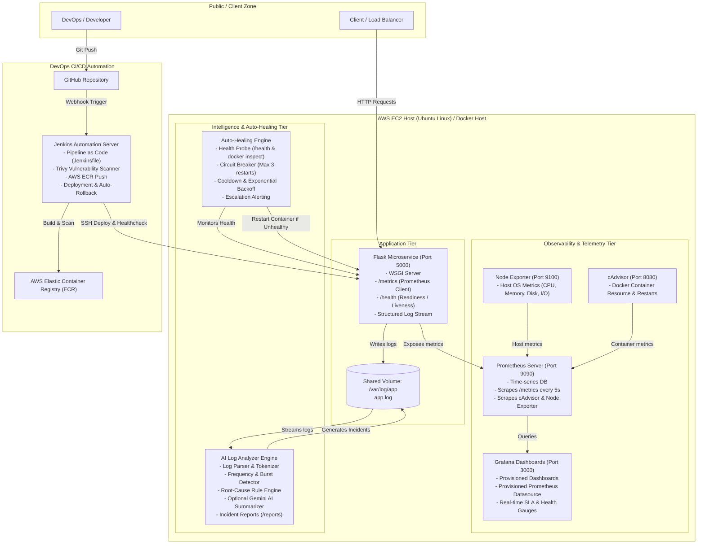
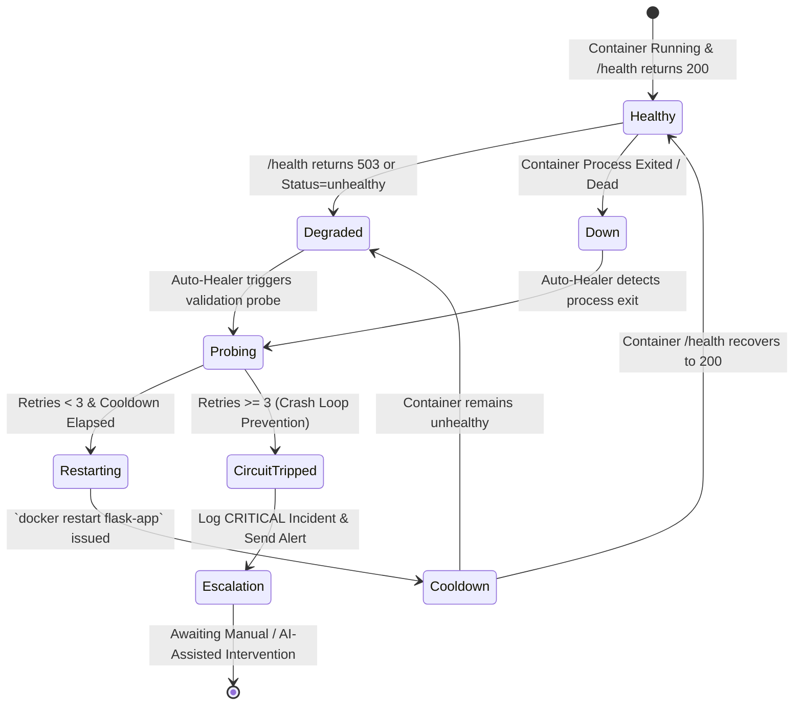

# System Architecture & Design Specification

## Project: AI-Powered DevOps Monitoring & Auto-Healing System

---

## 1. Executive Summary

In modern cloud-native architectures, high availability and low Mean Time to Recovery (MTTR) are vital. Traditional monitoring alerts on-call engineers after service degradation has occurred. 

This project implements an **autonomous, self-healing observability platform** combining:
- Containerized microservices (Flask + Docker).
- Full-stack observability (Prometheus + Grafana + cAdvisor + Node Exporter).
- Intelligent root-cause analysis (Rule-based anomaly detection + optional Gemini Generative AI).
- Safe closed-loop auto-recovery (Circuit-breaker auto-healing daemon).
- Automated CI/CD with security scanning & zero-downtime rollback (Jenkins + Trivy + AWS ECR/EC2).

---

## 2. High-Level Architecture Diagram



---

## 3. Core System Components

### 3.1 Application Layer (`/app`)
- **Framework**: Python 3.11 / Flask with `prometheus-client` and `psutil`.
- **Purpose**: Simulates real-world application workflows, handles high-throughput requests, exposes custom business & system metrics, and provides controlled chaos-testing endpoints (`/chaos/error`, `/chaos/slow`, `/chaos/unhealthy`).
- **Telemetry**: Emits structured log entries (`timestamp`, `level`, `endpoint`, `status`, `message`, `stack_trace`) and Prometheus metrics (`http_requests_total`, `http_request_duration_seconds`, `system_cpu_usage_percent`, `system_memory_usage_percent`, `app_health_status`).

### 3.2 Metrics & Observability Layer (`/monitoring`)
- **Prometheus (v2.51.0)**: Pulls metrics at 5-second intervals from targets defined in `prometheus.yml`. Retains historical time-series data for anomaly evaluation.
- **Node Exporter (v1.7.0)**: Gathers host-level operational metrics (host CPU, RAM, Disk I/O, Network saturation).
- **cAdvisor (v0.49.1)**: Gathers container-level operational metrics (per-container CPU limits, RSS memory, network RX/TX, container restart counts).
- **Grafana (v10.4.0)**: Features pre-configured, auto-provisioned dashboards loaded directly on container startup through YAML and JSON definitions.

### 3.3 AI Log Analyzer Layer (`/ai-analyzer`)
- **Parser & Classifier**: Scans active log files continuously or on schedule. Detects anomalies using regex pattern matching, frequency thresholds (e.g. >5 500-errors within 30 seconds), and stack trace identification.
- **Rule-Based Root Cause Engine**: Maps known system signatures (OOM exceptions, Database Connection Timeouts, Unhandled Null Pointers, HTTP 503 flapping) to actionable remediation steps.
- **Optional Gemini Generative AI Layer**: When `GEMINI_API_KEY` is provided, an anonymized log prompt is sent to Google Gemini to produce a natural-language diagnostic brief and recommended DevOps remediation.
- **Safety Safeguard**: Strips sensitive data (passwords, tokens, IP addresses) before external processing. Never executes shell commands directly from AI outputs.

### 3.4 Auto-Healing Layer (`/scripts/auto-healing.sh`)
- **Health Probing**: Polls container health state via Docker daemon API (`docker inspect --format '{{.State.Health.Status}}'`) and direct HTTP verification (`curl -f /health`).
- **Circuit Breaker Algorithm**:
  ```
  State: NORMAL -> (Failure detected) -> TRIGGER_RESTART -> (State = RESTARTING)
  If Restarts < MAX_RETRIES (3) within TIME_WINDOW (180s):
      Execute graceful container restart: `docker restart --time 10 <container>`
      Log healing event with timestamp and exit code
      Enter COOLDOWN (30s)
  If Restarts >= MAX_RETRIES:
      Trip Circuit Breaker -> State = CRITICAL_UNRECOVERABLE
      Halt automatic restarts to prevent crash-loop storms
      Emit CRITICAL escalation alert for human engineer
  ```
- **EC2 Safety Guarantee**: The auto-healing system is strictly isolated to application containers. It never initiates host-level reboot, network interface tear-down, or cloud provider resource deletion.

---

## 4. Failure Recovery & Auto-Healing State Machine



---

## 5. Security & Isolation Model

| Security Layer | Implemented Mechanism |
| :--- | :--- |
| **Container User** | Non-root `appuser` (UID 10001) in Dockerfile; drops Linux capabilities. |
| **Secrets Management** | Zero secrets in Git. Environment files (`.env`) loaded at runtime; Jenkins credentials vault for cloud tokens. |
| **Docker Network** | Isolated custom bridge network (`devops-network`); internal containers communicate via Docker DNS without public port bindings where unnecessary. |
| **AI Sanitizer** | Regex-based redaction of API keys, bearer tokens, passwords, and sensitive IP addresses prior to AI prompt generation. |
| **Vulnerability Scanning** | Trivy automated container image scanning in CI pipeline checking CVE severity thresholds. |
| **Rollback Safety** | Automated health validation post-deployment. Reverts instantly to previous stable image if health check fails. |
